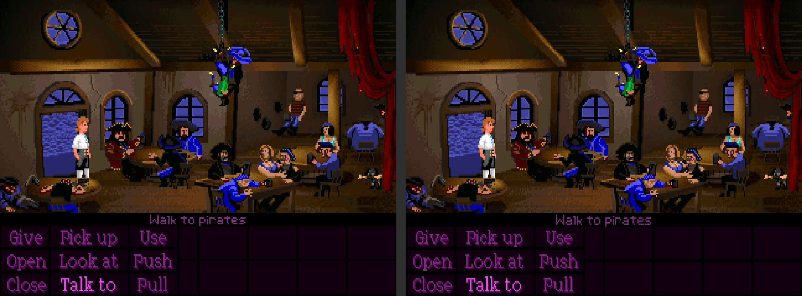
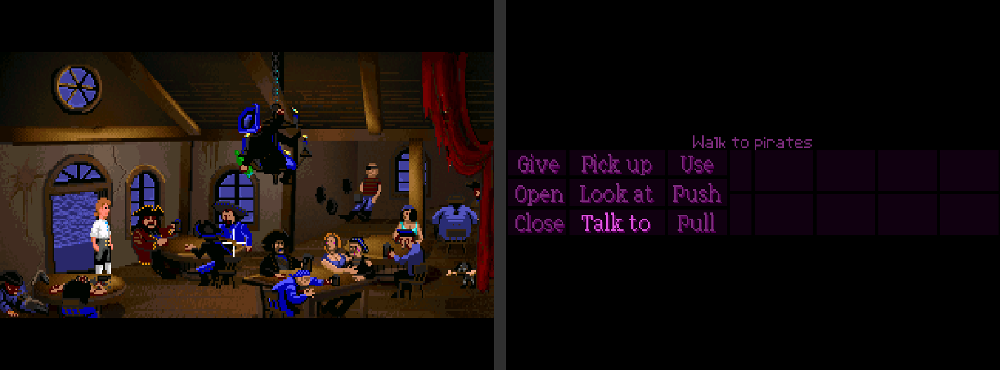
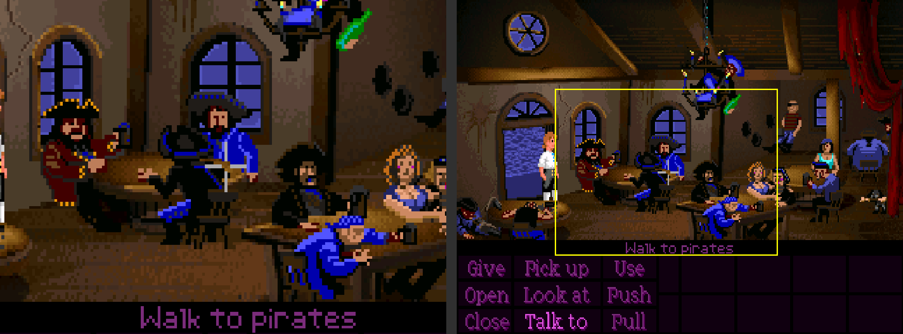
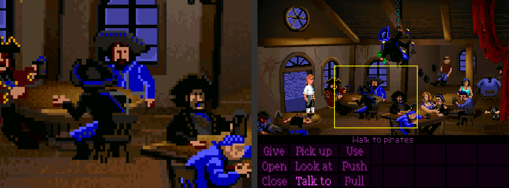

# ScummVM for bananaOS, with a second screen

[ScummVM](https://www.scummvm.org/) for **bananaOS** on the dual-screen **Anbernic RG DS** handhelds, where the bottom screen is
used instead of sitting idle. Unzip it on the card, put your games in a folder, start it from the ports list.

- **Mirror**: the same picture on both screens; tap the bottom screen to click.
- **Verb screen**: the room on the top screen, the sentence line, verbs and inventory enlarged on the bottom one. You tap a verb,
  the pointer jumps there, picks it, jumps back to what you had aimed at and clicks it. Made for the classic SCUMM games.
- **Zoom** (works in every game): the top screen shows an enlarged part of the picture that follows the pointer, the bottom screen
  the whole picture with a frame around what is enlarged. 1.5x, 2x and 3x.

One button (R2) goes round the three. Music in FLAC (the CD versions of the Monkey Islands), Ogg Vorbis and MP3 works.

| Mirror | Verb screen |
|---|---|
|  |  |

| Zoom 2x | Zoom 3x |
|---|---|
|  |  |

*(Left half of each picture: the top screen. Right half: the bottom screen. Game: The Secret of Monkey Island, CD version, on a
RG DS Plus. The game's graphics belong to their owners; no game files are included in this repository or the release.)*

## Install

1. Download `ScummVM-bananaos-two-screens-v1.1.zip` from the [latest release](../../releases/latest).
2. Unzip it at the **root of the data partition** (the card that holds `roms/`), so that `roms/ports/ScummVM.sh`,
   `roms/ports/ScummVM Two Screens.sh` and the folder `roms/ports/ScummVM/` end up next to your other ports.
3. Put each game in its own folder under `roms/scummvm/`, for example `roms/scummvm/monkey1/` with `MONKEY.000`, `MONKEY.001`
   and the music files in it. Games are not included, you need your own copies.
4. Start **ScummVM Two Screens** from the ports list (or **ScummVM** to use the top screen only). The games are registered
   automatically at every start, so a new folder only needs a restart.

That is all: nothing else has to be installed. The zip carries its own copies of the few libraries bananaOS lacks
(`libjpeg`, `libsndio`, `libbsd`, `libmd`, `libFLAC`, `libmad`), see [THIRD_PARTY.md](THIRD_PARTY.md).

**Tested on:** bananaOS 0.5.0.1, Anbernic RG DS Plus. Other versions or devices: not tested.
**Checked on the device:** the stick, A, touch in all three modes, the mode switch and the zoom following both stick and touch.
**Not yet checked button by button:** L1, L2, R1, L3, Y, Start, Select (they are set in `scummvm.gptk`; if one does nothing,
change it there).
**Tested games:** The Secret of Monkey Island (CD, DOS VGA): all three modes. Monkey Island 2 (Amiga) and Sam & Max Hit the Road
were detected and registered by ScummVM, but I have not played them through. Monkey Island 2 is in the verb-screen list (same layout, unverified);
Sam & Max is not, so for it R2 goes between mirror and zoom.

## Controls

The buttons are set in `roms/ports/ScummVM/scummvm.gptk` (a [gptokeyb](https://portmaster.games/) file) and can be changed there.
ScummVM's own game-controller handling is switched off (`--joystick=-1`), so only this file counts.

| Button | Does |
|---|---|
| Left stick, D-pad | move the pointer |
| **A**, **L1** | left click |
| **B**, **L2** | right click |
| **R1** (hold) | slow pointer, for aiming at small things |
| **R2** | next screen mode: mirror → verb screen → zoom → mirror |
| **L3** (press the left stick) | zoom level in the zoom mode: 1.5x → 2x → 3x |
| **X** | Esc (skip a cutscene, close a dialog) |
| **Y** | skip a line of dialogue (the `.` key of the SCUMM games) |
| **Start** | the game's menu (F5: save, load) |
| **Select** | pause (space) |
| Touch, bottom screen | click where you tap (in the verb screen: on the matching verb or inventory item) |
| **L + R** | quit (bananaOS' own combination) |

ScummVM's own menu (opened from inside a game) is only half visible in the verb screen; press R2 to go back to mirror while it
is open.

## Which games get the verb screen?

The top screen can only show "the room" if the game's interface sits at the bottom of the picture. `roms/ports/ScummVM/banana-split.txt`
lists the games for which that is set up (the title is the window title ScummVM gives while the game runs; the last matching line wins, `0` turns it off):

```
Monkey Island=144
Curse of Monkey Island=0
Indiana Jones and the Last Crusade=144
Indiana Jones and the Fate of Atlantis=144
Day of the Tentacle=144
Maniac Mansion=144
Zak McKracken=144
Loom=144
```

The number is the first game line (of 200) of the interface. ScummVM sets it to 144 by default for the classic SCUMM games
(`initScreens(16, 144)` in `engines/scumm/scumm.cpp`). **Only The Secret of Monkey Island is verified on the device**; the others follow
the same rule but have not been tried. The later games (Full Throttle, The Dig, Curse of Monkey Island) have no verb bar and only get mirror and zoom.
Sam & Max Hit the Road is not in the list: I do not know where its interface starts.

To add a game, find the line where its interface starts and add a line. To look at a game's picture, start it, then run on the
device over SSH `touch /tmp/banana-dump`; the next frame is written to `/tmp/banana-frame.ppm` (see [docs/HOW-IT-WORKS.md](docs/HOW-IT-WORKS.md)).
If a title is not matched, look in `log.txt` for the line `window title "..."`.

## How it works, in short

ScummVM is the unmodified upstream program (one commit, built for aarch64, only the SCUMM engine; see
[build/](build/) to change that). The second screen is a small library, `banana-second.so` ([src/banana-second.c](src/banana-second.c)),
that is loaded into ScummVM with `LD_PRELOAD`. It copies the finished picture ScummVM hands to SDL, draws it onto the bottom
panel through DRM (the same trick as in other bananaOS companion-screen ports), and rewrites touch input so that a tap on an
enlarged part lands on the right spot in the game. Details and the limits: [docs/HOW-IT-WORKS.md](docs/HOW-IT-WORKS.md).

## Building it yourself

See [build/](build/): a Debian 13 chroot with an aarch64 cross compiler, three scripts, and `package.py` for the zip.

```sh
sudo build/setup-chroot.sh /opt/trixie
sudo cp build/build-scummvm.sh build/build-shim.sh src/banana-second.c /opt/trixie/root/
sudo chroot /opt/trixie sh /root/build-scummvm.sh      # -> /opt/trixie/out/scummvm, out/lib/*.so
sudo chroot /opt/trixie sh /root/build-shim.sh         # -> /opt/trixie/out/lib/banana-second.so
python3 build/package.py /opt/trixie/out ScummVM-bananaos-two-screens.zip
```

## Known limits

- Only the SCUMM engine is built in (keeps the download small). To add engines, set `ENGINES=scumm,sci,...` for `build-scummvm.sh`;
  expect a bigger binary and more libraries.
- The verb screen is tuned for the screen layout of the early SCUMM games (verbs below the room). Other layouts (Sam & Max, the
  later games) are not set up yet. Zoom works everywhere.
- The first tap on a verb jumps the pointer for a moment and sets it back after about 250 ms; ScummVM only reads the click
  on its next tick. If the click sometimes goes missing, it can be raised with `BANANA_RETURN_MS`.
- ALSA prints "open /dev/snd/seq failed" lines in `roms/ports/ScummVM/log.txt`: ScummVM looks for a MIDI port the device does not have
  and falls back to its built-in synthesizers. Harmless.
- Touch precision is that of the capacitive screen; fine for verbs, harder for small objects. Use R1 and the stick for those.

## Credits

See [CREDITS.md](CREDITS.md). In short: the [ScummVM team](https://www.scummvm.org/) made ScummVM; the second-screen ideas come from
several earlier projects whose authors deserve the thanks: [PolluxPT/ScummVM-RGDSPlus](https://github.com/PolluxPT/ScummVM-RGDSPlus),
the ScummVM DS and 3DS ports, and the dual-screen Monkey Island pull request by glennjaume.

## Licence

GPL-3.0-or-later for the code in this repository ([LICENSE](LICENSE)). ScummVM is GPL-2.0-or-later; the bundled libraries have their
own licences ([THIRD_PARTY.md](THIRD_PARTY.md)). The built zip contains GPL software; the complete corresponding source is the pinned
upstream commit named in [THIRD_PARTY.md](THIRD_PARTY.md) plus this repository.
